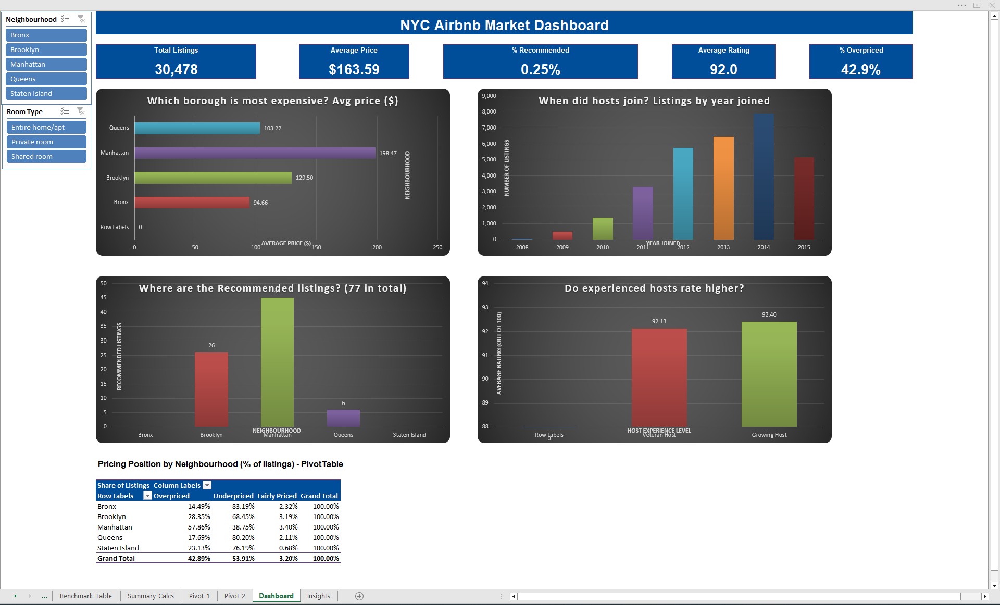

# NYC Airbnb Market Analysis (Excel)

An end-to-end analysis of **30,478 New York City Airbnb listings**, built entirely in Microsoft Excel. The goal is to understand pricing, host behaviour, and listing quality across NYC's five boroughs and turn the findings into a recommendation for the business.

## Business Questions
1. Which borough has the highest average price, and which has the most highly rated, heavily reviewed listings?
2. Does host tenure affect guest ratings?
3. What share of listings are priced above or below the market benchmark, by borough?
4. Which stay size earns the highest average rating?

## Dataset
Public NYC Airbnb listings data (~30K rows, 11 columns) covering hosts who joined between 2008 and 2015. Fields include host ID, join date, listing name, borough, property type, room type, zipcode, beds, number of reviews, nightly price, and review score.

## Tools & Skills
- **Data cleaning:** date standardization, text functions to split combined columns, handling blanks
- **Formulas:** IF, nested IF, AND, OR, VLOOKUP, SUM, SUMIF, COUNT, COUNTIF
- **Analysis:** PivotTables, PivotCharts, slicers
- **Reporting:** one-page interactive dashboard and written insights

## Workbook Structure
| Sheet | Contents |
|---|---|
| Raw_Backup | Original, untouched import |
| Cleaned_Data | Cleaned dates, split columns, and calculated fields |
| Benchmark_Table | Market benchmark price by room type |
| Summary_Calcs | Key totals and counts using aggregation formulas |
| Pivot_1 | Price, rating, and pricing position by borough and room type |
| Pivot_2 | Host experience, price tiers, stay size, and host growth by year |
| Dashboard | KPIs, charts, and slicers |
| Insights | Key findings and recommendation |

## Data Cleaning
- **Host Since dates** were stored inconsistently (text and true dates, mixed M/D/YYYY and MM/DD/YYYY formats). I converted them to real Excel dates with a helper column, then extracted Year Joined and Month Joined.
- **Room Type and Zipcode** were combined in a single column (e.g. "Private room 11206"). Splitting by space doesn't work because "Entire home/apt" contains spaces, so I separated them with text formulas and handled about 138 rows that had no zipcode.

## Calculated Columns
| Column | Rule |
|---|---|
| Recommended Place | Rating > 85 and at least 150 reviews |
| Price Tier | Cheaper (≤ $1,000), Average Cost ($1,001–3,000), Expensive ($3,001–5,000), Highly Expensive (> $5,000) |
| Best Choice to Stay | 3 beds, price $500–1,000, more than 80 reviews, rating > 90 |
| Host Experience Level | New (joined 2014+), Growing (2011–2013), Veteran (before 2011) |
| Stay Size Category | Studio/Solo (≤ 1 bed), Couple/Small Group (2–3), Large Group (4+) |
| High Demand Listing | 100+ reviews |
| Great Value Listing | Rating ≥ 90 and price ≤ $100 |
| Pricing Position | Price compared with the room-type benchmark via VLOOKUP: Overpriced, Underpriced, or Fairly Priced |

## Key Findings

| Borough | Avg Price | Listings | % Overpriced |
|---|---|---|---|
| Manhattan | $198 | 16,033 | 57.9% |
| Staten Island | $163 | 147 | 23.1% |
| Brooklyn | $130 | 11,675 | 28.4% |
| Queens | $103 | 2,278 | 17.7% |
| Bronx | $95 | 345 | 14.5% |

1. **Manhattan is the premium market.** It has the highest average price (about $198, roughly double the Bronx) and the most Recommended listings (45 of 77).
2. **Most listings are priced away from the benchmark.** 42.9% are above their room-type benchmark and 53.9% are below it. Manhattan is the only borough where most listings are overpriced, and shared rooms are the most often overpriced room type (about 60%).
3. **Host growth peaked in 2014**, with 7,908 listings from hosts who joined that year, compared with 5,153 for 2015.
4. **Host tenure has only a small effect on ratings.** Growing Hosts average 92.4, Veteran Hosts 92.1, and New Hosts 91.4. Studio/Solo listings rate highest (92.4) and Large Group listings lowest (90.0).
5. **Recommended status is rare.** Only 77 listings (0.25%) meet the threshold, mostly because few listings have 150+ reviews. In addition, 99.6% of listings fall into the "Cheaper" tier, which shows the tier bands are too wide for NYC prices.

## Recommendation
Offer Manhattan hosts a pricing guidance tool, starting with overpriced shared rooms and entire homes, that shows how each listing's price compares with the benchmark for its room type. Pair this with onboarding tips for new hosts, whose ratings trail more experienced hosts, to help more listings reach Recommended status.

## How to Use
Download `NYC_Airbnb_Market_Analysis.xlsx` and open it in Microsoft Excel. Use the slicers on the Dashboard sheet to filter the results.

## Author
**Salman Shahzad**, Data Analyst
[LinkedIn](https://www.linkedin.com/in/salmanshahzad888)
